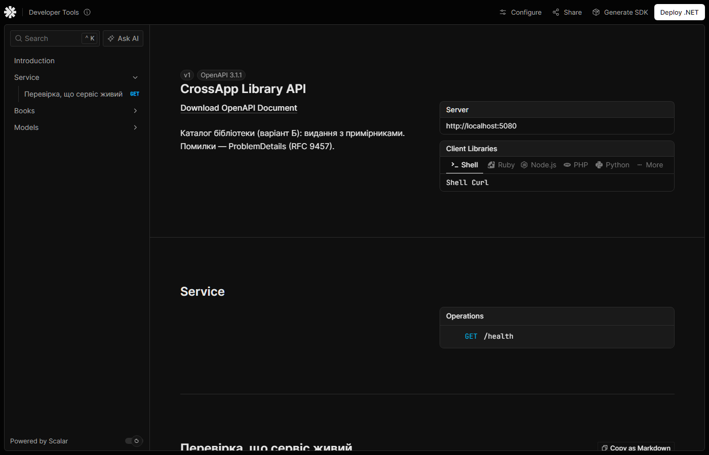
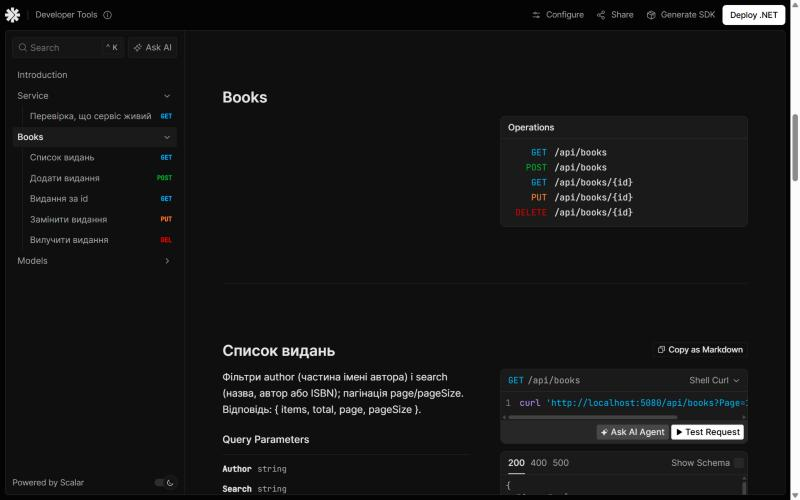

# CrossApp

Наскрізний навчальний проєкт з дисципліни **«Крос-платформне програмування»**.

- **Студент**: Шакула Володимир, група ФЕІ-32с
- **Предметна область**: Бібліотека (варіант Б)
- **Репозиторій**: <https://github.com/Volodrum/CPP_Lab_Shakula>
- **Середовище вимірювань**: Windows 11 Home x64 (10.0.26200), .NET SDK 10.0.400, runtime .NET 10.0.11

> Опис лабораторних 1–4 (з виводами консолі) — у [README_labs1-4.md](README_labs1-4.md), лабораторної 5 — у [README_lab05.md](README_lab05.md), 6 — у [README_lab06.md](README_lab06.md), 7 — у [README_lab07.md](README_lab07.md), 8 — у [README_lab08.md](README_lab08.md), 9 — у [README_lab09.md](README_lab09.md).

---

## Лабораторна робота 10. Minimal API: CRUD над Core, валідація, OpenAPI (Scalar)

**Мета**: відкрити функціональність доменного шару через HTTP API зі стабільними маршрутами, DTO замість доменних типів, коректними кодами HTTP і машинозчитуваними помилками (ProblemDetails, RFC 9457) — єдиний контракт для curl, Scalar UI, а з тижня 12 — Blazor-клієнта.

**Варіант (бібліотека)**: `/api/books` (isbn, title, author, year, copies) + `GET /api/books?author=...`.
Виконано всі чотири додаткові завдання: пагінація, FluentValidation через `AddEndpointFilter`, `DomainException → 409` окремим обробником, інтеграційні тести на `WebApplicationFactory`.

### Запуск

Порт зафіксовано в `src/Api/Properties/launchSettings.json`: **`http://localhost:5080`**, середовище `Development`.

| Команда | Що відбувається |
| :------ | :-------------- |
| `dotnet run --project src/Api` | API на `http://localhost:5080` (профіль `http` з launchSettings) |
| `dotnet run --project src/Api --urls http://localhost:5080` | Те саме з явним портом (якщо `Address already in use` — змініть порт тут) |
| `http://localhost:5080/scalar/v1` | Scalar UI (лише Development); `/` перенаправляє сюди |
| `http://localhost:5080/openapi/v1.json` | Документ OpenAPI 3.1 (лише Development) |
| `http://localhost:5080/health` | `{"status":"ok"}` |
| `src/Api/Api.http` | Увесь цикл create-read-update-delete + помилки для VS / Rider / VS Code REST Client |
| `dotnet test` | 72 тести: 54 `tests/Core.Tests` (42 + 12 нових `CatalogServiceTests`) і 18 `tests/Api.Tests` |
| `dotnet run --project src/Cli -- report-all` | Cli лишився робочим — той самий Core |
| `$env:ASPNETCORE_ENVIRONMENT="Production"; dotnet run --project src/Api --no-launch-profile --urls http://localhost:5080` | Production: Scalar і `/openapi` → 404 |
| `$env:Catalog__Store="File"; dotnet run --project src/Api` | API над `FileBookStore` тижня 9 (`bin/…/data/library-api.json`) |

### 1. Структура після лабораторної

```
CrossApp/
├── samples/api/                   ← тіла запитів для curl (book.json, book-invalid.json, …)
├── docs/lab10/                    ← знімки Scalar UI
├── src/
│   ├── Core/                      ← як і раніше без ASP.NET
│   │   ├── Services/CatalogService.cs     ← async CRUD каталогу: BookDraft → CatalogEntry, DomainException
│   │   ├── Storage/SynchronizedBookStore.cs ← декоратор lock для Singleton-сховища
│   │   └── Domain/IsbnRules.cs            ← public + IsValid (ним користується валідатор Api)
│   ├── Api/                       ← НОВЕ: друга точка входу
│   │   ├── Program.cs                     ← composition root: DI, ProblemDetails, OpenAPI/Scalar
│   │   ├── CatalogOptions.cs              ← секція "Catalog": Memory | File, Seed
│   │   ├── Contracts/                     ← BookDto, SaveBookRequest, BookListQuery, PagedResponse, BookMapping
│   │   ├── Endpoints/BookEndpoints.cs     ← п'ять маршрутів MapGroup("/api/books")
│   │   ├── Validation/                    ← FluentValidation-валідатори + ValidationFilter<T>
│   │   ├── Errors/ApiExceptionHandler.cs  ← IExceptionHandler: 409 / 400 / 500
│   │   ├── Properties/launchSettings.json ← порт 5080
│   │   ├── appsettings.json, Api.http
│   └── Cli/                       ← без змін
└── tests/
    ├── Core.Tests/CatalogServiceTests.cs
    └── Api.Tests/BooksApiTests.cs ← НОВЕ: WebApplicationFactory<Program>
```

Пакети `src/Api`: `Microsoft.AspNetCore.OpenApi` 10.0.14, `Scalar.AspNetCore` 2.19.0, `FluentValidation` 11.12.0. `tests/Api.Tests`: `Microsoft.AspNetCore.Mvc.Testing` 10.*.

### 2. Таблиця маршрутів

| Метод | Шлях | Тіло | Коди відповідей |
| :---- | :--- | :--- | :-------------- |
| GET | `/api/books?author=&search=&page=1&pageSize=20` | — | **200** `{ items, total, page, pageSize }`; **400** page < 1 або pageSize ∉ 1..100, `page=abc` |
| GET | `/api/books/{id}` | — | **200** `BookDto`; **404** |
| POST | `/api/books` | `SaveBookRequest` | **201** `BookDto` + `Location: /api/books/{id}`; **400** валідація / кривий JSON; **409** ISBN уже є; **415** без `Content-Type: application/json` |
| PUT | `/api/books/{id}` | `SaveBookRequest` | **200** `BookDto`; **400**; **404**; **409** ISBN зайнятий / зміна ISBN при наявних примірниках / вилучення виданих примірників |
| DELETE | `/api/books/{id}` | — | **204**; **404**; **409** є видані примірники або історія видач |
| GET | `/health` | — | **200** `{"status":"ok"}` |

Будь-який маршрут може дати **500** — ProblemDetails з `traceId`, без деталей винятку (описано в OpenAPI через `AddOpenApiOperationTransformer`).

### 3. Контракт JSON

```jsonc
// BookDto — відповідь (camelCase, кирилиця як є)
{ "id": "B-001", "isbn": "978-0-201-61622-4", "title": "Прагматичний програміст",
  "author": "Ендрю Гант", "year": 1999, "copies": 4, "available": 3 }

// SaveBookRequest — тіло POST / PUT; id видає сервер, available — наслідок видач
{ "isbn": "978-617-12-3456-7", "title": "Кобзар", "author": "Тарас Шевченко", "year": 1840, "copies": 2 }
```

`copies` у запиті — **бажана** кількість примірників: POST реєструє їх, PUT додає бракуючі або вилучає зайві вільні. Тому PUT ідемпотентний: те саме тіло вдруге не змінює стан.

| Поле | Правило (`SaveBookRequestValidator`) | Повідомлення |
| :--- | :----------------------------------- | :----------- |
| `isbn` | обов'язковий; 10 або 13 цифр, дефіси дозволені (`IsbnRules.IsValid` з Core) | «ISBN обов'язковий.» / «ISBN має містити 10 або 13 цифр…» |
| `title` | обов'язкова, ≤ 200 символів | «Назва обов'язкова, до 200 символів.» |
| `author` | необов'язковий, ≤ 120 символів | «Автор — до 120 символів.» |
| `year` | 1450..поточний рік (`Book.MinYear`) | «Рік видання має бути в межах 1450..2026.» |
| `copies` | 0..100 (`CatalogService.MaxCopies`) | «Кількість примірників має бути від 0 до 100.» |

Ключі словника `errors` — імена властивостей (`Isbn`, `Title`, …): саме так Blazor `EditContext` ідентифікує поля форми.

### 4. Приклади curl

> На Windows тіло з кирилицею передавайте файлом (`--data-binary @файл`): аргумент командного рядка `-d '…'` консоль може перекодувати не в UTF-8, і сервер чесно відповість 400 «Значення має неправильний тип або формат». У PowerShell пишіть `curl.exe`, а не `curl` (там це псевдонім `Invoke-WebRequest`).

bash / Git Bash:

```bash
curl -i -X POST http://localhost:5080/api/books -H "Content-Type: application/json" --data-binary @samples/api/book.json
curl -i http://localhost:5080/api/books/B-7145dc66
curl -i -X PUT http://localhost:5080/api/books/B-7145dc66 -H "Content-Type: application/json" --data-binary @samples/api/book-put.json
curl -i -X DELETE http://localhost:5080/api/books/B-7145dc66
curl -i "http://localhost:5080/api/books?author=%D0%BC%D0%B0%D1%80%D1%82%D1%96%D0%BD&page=1&pageSize=2"   # author=мартін
```

PowerShell:

```powershell
curl.exe -i -X POST http://localhost:5080/api/books -H "Content-Type: application/json" --data-binary "@samples/api/book.json"
```

**POST → 201** (вивід `curl.exe -i` у PowerShell):

```
HTTP/1.1 201 Created
Content-Type: application/json; charset=utf-8
Location: /api/books/B-7145dc66

{"id":"B-7145dc66","isbn":"978-617-12-3456-7","title":"Кобзар","author":"Тарас Шевченко","year":1840,"copies":2,"available":2}
```

**POST з невалідними полями → 400** (`samples/api/book-invalid.json`: `{"isbn":"","title":"X","author":null,"year":3000,"copies":-1}`):

```
HTTP/1.1 400 Bad Request
Content-Type: application/problem+json

{"type":"https://tools.ietf.org/html/rfc9110#section-15.5.1","title":"One or more validation errors occurred.","status":400,
 "errors":{"Isbn":["ISBN обов'язковий."],"Year":["Рік видання має бути в межах 1450..2026."],"Copies":["Кількість примірників має бути від 0 до 100."]},
 "traceId":"00-63525e879e36376c30ac8e44d3a17178-37b3a3cd4311b056-00"}
```

**Повний цикл create-read-update-delete** (Git Bash, тіла з `samples/api`):

```
### POST
HTTP/1.1 201 Created
Location: /api/books/B-07c241b5
{"id":"B-07c241b5","isbn":"978-617-12-3456-7","title":"Кобзар","author":"Тарас Шевченко","year":1840,"copies":2,"available":2}
### GET
HTTP/1.1 200 OK
{"id":"B-07c241b5","isbn":"978-617-12-3456-7","title":"Кобзар","author":"Тарас Шевченко","year":1840,"copies":2,"available":2}
### PUT
HTTP/1.1 200 OK
{"id":"B-07c241b5","isbn":"978-617-12-3456-7","title":"Кобзар (перше видання)","author":"Тарас Шевченко","year":1840,"copies":3,"available":3}
### PUT з порожньою назвою
HTTP/1.1 400 Bad Request
{"type":"https://tools.ietf.org/html/rfc9110#section-15.5.1","title":"One or more validation errors occurred.","status":400,"errors":{"Title":["Назва обов'язкова, до 200 символів."]},"traceId":"00-5cff…-00"}
### POST з тим самим ISBN
HTTP/1.1 409 Conflict
{"type":"https://tools.ietf.org/html/rfc9110#section-15.5.10","title":"Операція суперечить правилам бібліотеки.","status":409,"detail":"Видання з ISBN 978-617-12-3456-7 уже є в каталозі: B-07c241b5.","traceId":"00-c986…-00"}
### DELETE
HTTP/1.1 204 No Content
### GET після DELETE
HTTP/1.1 404 Not Found
{"type":"https://tools.ietf.org/html/rfc9110#section-15.5.5","title":"Not Found","status":404,"traceId":"00-9a17…-00"}
```

**Тіло, що не розібралося, → 400, не 500:**

```
POST порожнє тіло            → 400 {"title":"Запит не вдалося розібрати.","status":400,"detail":"Тіло порожнє або не JSON, чи параметр запиту має неправильний тип (наприклад, page=abc).",…}
POST "copies":"abc"          → 400 {"title":"One or more validation errors occurred.","status":400,"errors":{"Copies":["Значення має неправильний тип або формат."]},…}
POST без Content-Type        → 415 {"title":"Unsupported Media Type","status":415,…}
GET ?page=0&pageSize=500     → 400 {"errors":{"Page":["Номер сторінки починається з 1."],"PageSize":["Розмір сторінки має бути від 1 до 100."]},…}
DELETE /api/books/B-001      → 409 {"detail":"Видання B-001 не можна вилучити: 1 з 4 примірн. видано читачам або мають історію видач.",…}
```

**Пагінація + фільтр автора** (`?author=мартін&page=1&pageSize=2`):

```json
{"items":[
  {"id":"B-010","isbn":"978-0-201-48567-7","title":"Рефакторинг","author":"Мартін Фаулер","year":1999,"copies":3,"available":2},
  {"id":"B-006","isbn":"978-0-13-449416-6","title":"Чиста архітектура","author":"Роберт Мартін","year":2017,"copies":4,"available":3}],
 "total":3,"page":1,"pageSize":2}
```

### 5. Scalar UI





### 6. Чому DTO окремо від доменної сутності

`Book` — це правила (приватний конструктор, `Create` з перевірками, незмінність), а не формат передачі: серіалізатор не зміг би створити його з JSON в обхід `Create`, а віддаючи `Book` назовні, ми б зробили кожну внутрішню зміну (перейменоване поле, нова властивість) зламом для клієнтів. `BookDto` складається з того, що потрібно клієнту, — зокрема `copies`/`available`, яких у `Book` немає взагалі (вони рахуються з примірників), а `SaveBookRequest` містить лише те, що клієнт має право задати (без `id` і `available`). У проєкті тепер три різні «книжкові» формати з різними причинами змінюватися: доменний `Book`, файловий `Core.Dto.BookDto` з полем `kind` і HTTP-контракт `Api.Contracts.BookDto`.

### 7. Час життя сервісів у DI

| Реєстрація | Час життя | Чому |
| :--------- | :-------- | :--- |
| `IBookStore` → `SynchronizedBookStore(InMemoryBookStore(SampleData))` | **Singleton** | Дані в пам'яті мусять пережити запит; Scoped дав би новий порожній (або заново засіяний) каталог на кожен запит, і після POST GET повертав би 404 |
| `CatalogService` | **Singleton** | Його `SemaphoreSlim` робить «перевірити ISBN → додати книгу → додати примірники» атомарним лише тоді, коли сервіс один на весь застосунок |
| `IValidator<SaveBookRequest>`, `IValidator<BookListQuery>` | **Singleton** | Без стану, потокобезпечні |
| `ValidationFilter<T>` | створюється для кінцевої точки | Бере валідатор з DI через конструктор |

Singleton бачать усі паралельні запити одночасно, а `Dictionary` всередині `InMemoryBookStore` до цього не готовий. Тому сховище загорнуто в декоратор `SynchronizedBookStore` (кожен виклик під `lock`), а кількакрокові зміни додатково серіалізує `SemaphoreSlim` у `CatalogService` (його можна чекати через `await`, на відміну від `lock`). Тест `CreateAsync_ConcurrentSameIsbn_OnlyOneSucceeds`: 20 паралельних POST з одним ISBN — рівно один успіх. На тижні 11 `DbContext` EF Core стане **Scoped** (він не потокобезпечний і тримає одиницю роботи одного запиту), а отже й сервіс над ним.

```csharp
// src/Api/Program.cs
builder.Services.AddSingleton<IBookStore>(_ => new SynchronizedBookStore(CreateStore(builder.Configuration)));
builder.Services.AddSingleton<CatalogService>();
builder.Services.AddSingleton<IValidator<SaveBookRequest>, SaveBookRequestValidator>();
builder.Services.AddSingleton<IValidator<BookListQuery>, BookListQueryValidator>();
```

Обробники отримують `CatalogService` (а через нього — сховище) **параметром делегата**: `async (string id, CatalogService catalog, CancellationToken ct) => …`. `id` береться з маршруту, `SaveBookRequest` — з тіла JSON, `BookListQuery` (`[AsParameters]`) — з рядка запиту, `CancellationToken` — з `HttpContext.RequestAborted`.

### 8. Помилки: що бачить клієнт

`AddProblemDetails()` + `UseExceptionHandler()` + `AddExceptionHandler<ApiExceptionHandler>()` + `UseStatusCodePages()`:

| Причина | Хто обробляє | Відповідь |
| :------ | :----------- | :-------- |
| Порушено правило поля | `ValidationFilter<T>` (до обробника) | 400 `ValidationProblem` з `errors` |
| JSON поля не того типу (`"copies":"abc"`) | `ApiExceptionHandler` (`BadHttpRequestException` + `JsonException.Path`) | 400 з `errors.Copies` |
| Порожнє тіло, `page=abc` | `ApiExceptionHandler` (`BadHttpRequestException`) | 400 ProblemDetails |
| `DomainException` (дубль ISBN, видані примірники) | `ApiExceptionHandler` | 409 ProblemDetails з `detail` |
| Немає ресурсу | обробник → `TypedResults.NotFound()`, тіло — `UseStatusCodePages` | 404 ProblemDetails |
| Будь-що інше | `ApiExceptionHandler` | 500 «Внутрішня помилка сервера» + `traceId`; виняток — лише в журнал |

`RouteHandlerOptions.ThrowOnBadRequest = true` в усіх середовищах: помилки зв'язування завжди приходять в обробник винятків, тож відповідь однакова в Development і Production. Тест `UnexpectedException_Returns500_WithoutInternals` підміняє сховище на те, що кидає `IOException` зі шляхом `C:\srv\secret\library.json`, і перевіряє, що в тілі немає ні `Exception`, ні шляху, ні stack trace.

### 9. Додаткові завдання

1. **Пагінація** — `GET /api/books?page=1&pageSize=20&search=...&author=...` → `{ items, total, page, pageSize }`. `search` шукає в назві, авторі й ISBN (без дефісів), сортування стабільне (назва за `uk-UA`, потім id), `page=int.MaxValue` не переповнює `Skip`.
2. **FluentValidation через `AddEndpointFilter`** — `SaveBookRequestValidator`, `BookListQueryValidator`; `ValidationFilter<T>` шукає аргумент типу `T`, валідує і повертає `TypedResults.ValidationProblem(result.ToDictionary())`; `.Validate<T>()` також додає `ProducesValidationProblem()` для OpenAPI.
3. **`DomainException → 409`** — `ApiExceptionHandler : IExceptionHandler`; правила, що кидають `DomainException`, живуть у `CatalogService` (Core), а Api лише перекладає їх у HTTP.
4. **Інтеграційні тести** — `tests/Api.Tests` (18): POST → 201 → GET за `Location` → 200; повний CRUD-цикл; 400 для полів, порожнього тіла, кривого JSON, масиву замість об'єкта, `"copies":"abc"`, PUT з порожньою назвою; 415; 409 для дубля й видання з видачами; фільтр + пагінація; OpenAPI описує п'ять маршрутів; у Production немає `/openapi` і `/scalar`; 500 без деталей.

### 10. Самоперевірка

| Питання | Результат |
| :------ | :-------- |
| Scalar `/scalar/v1` показує всі п'ять маршрутів? | Так (знімок вище; тест `OpenApiDocument_DescribesAllFiveBookRoutes`) |
| Цикл create-read-update-delete, після DELETE GET → 404? | Так (розділ 4; тест `CrudCycle_AfterDelete_GetReturns404`) |
| Порожнє тіло POST і `"copies":"abc"` → 400, не 500? | Так (тести `Post_UnreadableBody_Returns400`, `Post_WrongFieldType_Returns400ForThatField`) |
| У відповідях немає `Exception` і шляхів з диска, Core — без ASP.NET? | Так; `Core.csproj` — `Microsoft.NET.Sdk` без пакетів і без `FrameworkReference` |

### 11. Definition of Done (Лабораторна робота 10)

1. CRUD через HTTP; OpenAPI/Scalar у Development описує всі маршрути — розділи 2, 5.
2. Валідація дає 400 з переліком полів, відсутність сутності — 404 — розділ 4.
3. Виняток не показує клієнтові деталей; сховище — через DI — розділи 7, 8.
4. Порт і команди запуску в README з прикладами curl — «Запуск», розділ 4.
5. Cli і тести працюють; `dotnet build` (0 попереджень) і `dotnet test` (72/72) зелені; коміт `lab10`.

### 12. Відповіді на питання на захисті

1. **Minimal API vs контролери.** Minimal API — маршрут і лямбда-обробник без класу, базового типу й атрибутної магії; мало коду, швидкий старт, явна залежність кожного обробника. Контролери зручніші, коли кінцевих точок десятки й потрібні фільтри/конвенції MVC, model binding з `[ApiController]`, спільна база для групи дій, Razor-представлення. Групування й фільтри тут дають `MapGroup` і `AddEndpointFilter`.
2. **Навіщо DTO.** Див. розділ 6: стабільний контракт незалежно від домену, лише потрібні клієнту поля (`copies`/`available` є тільки в DTO), сутність з інваріантами не створюється серіалізатором в обхід `Create`.
3. **Звідки параметри делегата і коли 400/404/409/500.** `id` — з шаблону маршруту, складний тип — з тіла JSON, `[AsParameters]` — з рядка запиту, зареєстровані типи (`CatalogService`) — з DI, `CancellationToken` — з `RequestAborted`. 400 — запит некоректний (валідація, кривий JSON); 404 — ресурсу з таким id немає; 409 — запит коректний, але суперечить стану (дубль ISBN, видані примірники); 500 — збій сервера, клієнт тут ні до чого.
4. **201 і ідемпотентність.** 201 Created має тіло зі створеним ресурсом і заголовок `Location` з його адресою. PUT ідемпотентний: N однакових запитів = один (той самий стан, `copies` — бажана кількість, а не приріст); POST — ні: кожен створює нове видання з новим id (тут другий з тим самим ISBN отримає 409).
5. **Singleton / Scoped / Transient.** Один на застосунок / один на HTTP-запит / новий при кожному отриманні. Для сховища в пам'яті — Singleton (дані живуть між запитами) з `lock` через `SynchronizedBookStore`; детальніше — розділ 7.
6. **ProblemDetails.** Стандартний JSON (`type`, `title`, `status`, `detail`, `instance` + розширення `errors`, `traceId`) з `Content-Type: application/problem+json`. Клієнт розбирає його однаково для всіх API і всіх помилок, а Blazor покаже `errors.Title` біля поля «Назва» — з рядка «щось пішло не так» це не витягнути.
7. **Чому OpenAPI/Scalar лише в Development.** Документ розкриває всю поверхню API (маршрути, схеми, коди) — зайва підказка атакувальнику, а UI з кнопкою «Test Request» не має бути в продакшені. Тест `Production_HidesOpenApiAndScalar` це перевіряє.
8. **Що зміниться з EF Core (тиждень 11).** Новий клас `EfBookStore : IBookStore` над `DbContext` з SQLite і кілька інших рядків реєстрації в `Program.cs` (`AddDbContext` + Scoped замість Singleton для сховища й `CatalogService`; `SemaphoreSlim` поступиться унікальному індексу на ISBN і транзакціям). Маршрути, DTO, коди й формат помилок не зміняться — інтеграційні тести мають пройти без правок.

### 13. Що змінилося в коді попередніх лабораторних

- `Core.Domain.IsbnRules` став `public` і отримав `IsValid(string?)` — валідатор Api використовує те саме правило, що й домен; `Normalize` тепер викликає `IsValid`.
- Нові класи Core (`CatalogService`, `SynchronizedBookStore`) нічого не змінюють у `LendingService`, сховищах і Cli; `IBookStore` лишився синхронним, як і було вирішено на тижні 9, а асинхронність із `CancellationToken` — на рівні сервісу.
- Опис лабораторної 9 перенесено в [README_lab09.md](README_lab09.md).
