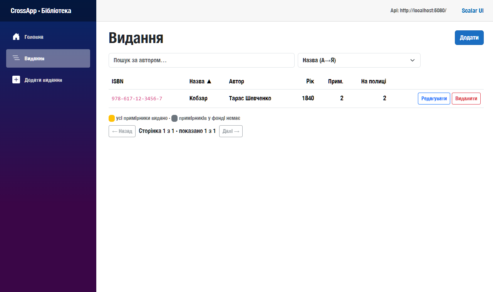

# CrossApp

Наскрізний навчальний проєкт з дисципліни **«Крос-платформне програмування»**.

- **Студент**: Шакула Володимир, група ФЕІ-32с
- **Предметна область**: Бібліотека (варіант Б)
- **Репозиторій**: <https://github.com/Volodrum/CPP_Lab_Shakula>
- **Середовище вимірювань**: Windows 11 Home x64 (10.0.26200), .NET SDK 10.0.400, runtime .NET 10.0.11, dotnet-ef 10.0.15, bUnit 2.15.2

> Опис лабораторних 1–4 (з виводами консолі) — у [README_labs1-4.md](README_labs1-4.md), лабораторної 5 — у [README_lab05.md](README_lab05.md), 6 — у [README_lab06.md](README_lab06.md), 7 — у [README_lab07.md](README_lab07.md), 8 — у [README_lab08.md](README_lab08.md), 9 — у [README_lab09.md](README_lab09.md), 10 — у [README_lab10.md](README_lab10.md), 11 — у [README_lab11.md](README_lab11.md).

---

## Лабораторна робота 12. Blazor-клієнт до власного API: перегляд, створення, редагування

**Мета**: завершити наскрізний кросплатформний цикл браузерним інтерфейсом. Blazor-застосунок показує і змінює дані лише через HTTP-контракт `/api/books`, без доступу до бази даних і без дублювання бізнес-правил.

**Варіант (бібліотека)**: список видань з автором і кількістю примірників, пошук за автором; форма видання (створення/редагування).
Назви з методички відповідають так: `Products.razor` → `Books.razor`, `ProductEdit.razor` → `BookEdit.razor`, `ProductsApiClient` → `BooksApiClient`, `ProductModel` → `BookModel`.

Виконано всі чотири додаткові завдання:

1. **Видалення з підтвердженням** — модальне вікно, `DELETE /api/books/{id}`, після 204 список перечитується без перезавантаження сторінки; 409 (є видачі) показується поясненням сервера.
2. **Пошук і сортування на боці Api** — `GET /api/books?author=&sort=title|author|year|copies` (мінус — спадання), сортування в `CatalogService` до пагінації; невідомий `sort` → 400.
3. **Спільний проєкт `src/Contracts`** з DTO для Api і Web (`BookDto`, `SaveBookRequest`, `PagedResponse<T>`, `BookSort`) — плюси і мінуси в розділі 7.
4. **Скасування запитів** — `CancellationTokenSource` у сторінках: новий пошук скасовує попередній запит (debounce 300 мс), перехід на іншу сторінку скасовує незавершений.

### Запуск (два процеси)

| Термінал | Команда (з кореня репозиторію) | Порт |
| :------- | :----------------------------- | :--- |
| 1 — Api | `dotnet run --project src/Api --urls http://localhost:5080` | `http://localhost:5080` (Scalar: `/scalar/v1`) |
| 2 — Web | `dotnet run --project src/Web --urls http://localhost:5090` | `http://localhost:5090/books` |
| перевірка контракту до UI | `curl -s http://localhost:5080/api/books` | — |
| тести | `dotnet test` | 144 тести: 57 Core + 20 Infrastructure + 29 Api + 38 Web |

Обидва порти зафіксовано також у `Properties/launchSettings.json` (профіль `http`), тож `dotnet run --project src/Api` і `dotnet run --project src/Web` без `--urls` дають ті самі адреси. Порядок: спочатку Api, потім Web (Web без Api запускається, але показує «Api недоступний…»).

Порожній каталог для демонстрації «Записів ще немає.» — окремий файл БД без сідування:

```bash
ConnectionStrings__AppDb="Data Source=data/demo.db" Catalog__Seed=false dotnet run --project src/Api --urls http://localhost:5080
```

**Ключі конфігурації:**

| Проєкт | Ключ | Значення за замовчуванням | Призначення |
| :----- | :--- | :------------------------ | :---------- |
| Web | `Api:BaseUrl` | `http://localhost:5080` | базова адреса Api для `AddHttpClient<BooksApiClient>`; змінна середовища `Api__BaseUrl` |
| Web | `Api:TimeoutSeconds` | `10` | `HttpClient.Timeout`: завислий Api дає повідомлення, а не вічне «Завантаження…» |
| Api | `Cors:WebOrigin` | `http://localhost:5090` | origin браузерного клієнта для CORS (кілька — через `,`); змінна `Cors__WebOrigin` |
| Api | `ConnectionStrings:AppDb` | `Data Source=data/app.db` | без змін з тижня 11; у Web такого ключа немає |

На тижні 14 ці ключі підмінить конфігурація розгортання (змінні середовища контейнера), код не зміниться.

### 1. Обраний режим: Blazor Web App, Interactive Server

```bash
dotnet new blazor -n Web -o src/Web -f net10.0 --interactivity Server --all-interactive
dotnet new classlib -n Contracts -o src/Contracts -f net10.0
dotnet sln add src/Web/Web.csproj src/Contracts/Contracts.csproj tests/Web.Tests/Web.Tests.csproj
```

**Де виконується код.** Увесь C#-код компонентів (`Books.razor`, `BookEdit.razor`) і `BooksApiClient` виконується **на сервері, у процесі Web** (порт 5090). Браузер завантажує лише HTML, CSS і `blazor.web.js`, відкриває WebSocket `/_blazor` (SignalR) і надсилає туди події (клік, введення), а у відповідь отримує різницю DOM. DLL застосунку в браузер не потрапляють.

Режим задано глобально в `Components/App.razor` для всіх маршрутизованих сторінок:

```razor
<Routes @rendermode="PageRenderMode" />
@code {
    private static readonly IComponentRenderMode PageRenderMode = new InteractiveServerRenderMode(prerender: false);
}
```

`prerender: false` — сторінка не рендериться двічі (статично, а потім інтерактивно), тому Api викликається один раз на відкриття, і користувач бачить стан «Завантаження…». Окремий `@rendermode InteractiveServer` на сторінках не потрібен: він уже успадковується від `Routes`.

**Чому Server, а не WebAssembly.** Server-режим не потребує завантаження .NET-рантайму в браузер, а `HttpClient` звертається до Api з сервера. Адреса Api, тайм-аути й логування лишаються на сервері. Мінус — потрібне постійне з'єднання SignalR (його розрив показує `ReconnectModal`), а кожна взаємодія — це мережевий обмін із сервером Web.

### 2. Структура і залежності

```
src/
├── Contracts/                 ← НОВЕ (дод. 3): DTO HTTP-контракту, без жодних залежностей
│   ├── BookDto.cs, SaveBookRequest.cs, PagedResponse.cs   ← перенесено з src/Api/Contracts (JSON той самий)
│   └── BookSort.cs                                        ← допустимі значення ?sort=
├── Api/                       ← + CORS (Cors:WebOrigin), + ?sort=, + посилання на Contracts
├── Core/                      ← CatalogService.SearchAsync: сортування до пагінації (CatalogSortField)
├── Infrastructure/            ← без змін
├── Cli/                       ← без змін
└── Web/                       ← НОВЕ: Blazor Web App, Interactive Server
    ├── Program.cs                     ← AddHttpClient<BooksApiClient>(BaseAddress з Api:BaseUrl)
    ├── appsettings.json               ← "Api": { "BaseUrl": "http://localhost:5080", "TimeoutSeconds": 10 }
    ├── Contracts/BookModel.cs         ← модель форми + Data Annotations (для зручності)
    ├── Contracts/ApiResult.cs         ← ApiResult, ValidationProblemResponse
    ├── Contracts/BookListRequest.cs   ← author/sort/page → query-рядок
    ├── Services/BooksApiClient.cs     ← List/Find/Create/Update/Delete/Ping, розбір 400/404/409/збоїв
    └── Components/
        ├── App.razor                  ← глобальний InteractiveServer (prerender: false)
        ├── Layout/MainLayout.razor    ← адреса Api і посилання на Scalar беруться з BooksApiClient.BaseAddress
        └── Pages/Home.razor, Books.razor, BookEdit.razor
tests/Web.Tests/               ← НОВЕ: 38 тестів (клієнт, bUnit-сторінки, наскрізні з Api, архітектура)
```

`Web` → `Contracts` — єдине посилання. Ні `Core`, ні `Infrastructure`, ні EF Core чи рядка підключення у Web немає (тести `WebProject_ReferencesOnlyContracts`, `WebAssembly_DoesNotLoadDataAccess`, `WebAppsettings_HasApiBaseUrl_AndNoConnectionString`).

### 3. Типізований HttpClient і конфігурація

```csharp
// src/Web/Program.cs
var apiBaseUrl = builder.Configuration["Api:BaseUrl"]
    ?? throw new InvalidOperationException("Не задано Api:BaseUrl (appsettings.json або змінна Api__BaseUrl).");
builder.Services.AddHttpClient<BooksApiClient>(client =>
{
    client.BaseAddress = apiBaseUri;   // http://localhost:5080/ — зі слешем, відносні "api/books" додаються до нього
    client.Timeout = apiTimeout;       // Api:TimeoutSeconds
});
```

У жодному `.razor` / `.cs` файлі Web немає `localhost` чи порту Api — це перевіряє тест `WebSources_HaveNoHardcodedApiAddress`. Навіть посилання «Scalar UI» у шапці будується від `BooksApiClient.BaseAddress`.

### 4. Сторінки, маршрути, виклики Api

| Сторінка | Маршрут UI | Виклик Api | Код відповіді |
| :------- | :--------- | :--------- | :------------ |
| Головна (стан Api) | `/` | `GET /health` | 200 / немає відповіді → «Api недоступний…» |
| Список видань | `/books` | `GET /api/books?page=1&pageSize=10` | 200 |
| Пошук за автором | `/books` (поле пошуку) | `GET /api/books?author=шевч&page=1&pageSize=10` | 200 (`total: 0` → «Видань автора … не знайдено.») |
| Сортування | `/books` (клік по заголовку / список) | `GET /api/books?sort=-year&…` | 200; невідомий `sort` → 400 |
| Створення | `/books/new` → «Зберегти» | `POST /api/books` | 201 → перехід на `/books`; 400; 409 (дубль ISBN) |
| Редагування (завантаження) | `/books/{id}` | `GET /api/books/{id}` | 200; 404 → «Видання з id … не знайдено (404)» |
| Редагування (збереження) | `/books/{id}` → «Зберегти» | `PUT /api/books/{id}` | 200; 400; 404; 409 |
| Видалення | `/books` → «Видалити» → підтвердження | `DELETE /api/books/{id}` | 204 → список перечитано; 409 (є видачі); 404 |

Журнал Api під час сценарію захисту (`Logging__LogLevel__Microsoft.AspNetCore.Hosting.Diagnostics=Information`), скорочено:

```text
GET    /api/books?page=1&pageSize=10        - 200     ← порожній список
POST   /api/books                           - 201     ← форма «Кобзар»
GET    /api/books/B-febbd3f8                - 200     ← відкрито форму редагування
PUT    /api/books/B-febbd3f8                - 200
POST   /api/books                           - 400     ← невалідна форма
POST   /api/books                           - 409     ← дубль ISBN
GET    /api/books/B-404                     - 404
GET    /api/books?sort=-year&page=1&pageSize=10 - 200
GET    /api/books?author=%D1%88%D0%B5%D0%B2%D1%87&sort=-year&page=1&pageSize=10 - 200
DELETE /api/books/B-c3eef009                - 204
```

### 5. Обробка помилок

| Ситуація | Що повертає `BooksApiClient` | Що бачить користувач |
| :------- | :--------------------------- | :------------------- |
| Api не запущений / мережа | `HttpRequestException` → `ApiUnavailableException` (читання) або `ApiResult(false, …)` (зміни) | «Api недоступний. Перевірте, чи запущено src/Api.» + кнопка «Повторити» |
| Api завис довше `Api:TimeoutSeconds` | тайм-аут `HttpClient` → те саме | «Api не відповів вчасно (Api:TimeoutSeconds).» |
| 404 на `GET /api/books/{id}` | `null` (не виняток) | «Видання з id «B-404» не знайдено (404)…» замість форми |
| 404 на PUT/DELETE | `ApiResult(false, "Запис не знайдено…")` | загальне повідомлення |
| 400 ValidationProblem | `ApiResult(false, "Дані не пройшли перевірку.", errors)` | загальний список «Поле: текст» + повідомлення під кожним полем (`ValidationMessageStore`) |
| 409 Conflict | `ApiResult(false, detail)` | окреме жовте повідомлення над формою, біля полів нічого |
| 5xx | `ApiResult(false, "Сервер повернув 500.")` | загальне повідомлення |
| користувач пішов зі сторінки | `OperationCanceledException` | нічого (запит скасовано, не помилка) |

Ключі словника `errors` з Api (`Isbn`, `Title`, `Year`, `Copies`) збігаються з іменами властивостей `BookModel`, тож `BookEdit` кладе кожне повідомлення у `ValidationMessageStore` для поля з тим самим іменем. Коли користувач змінює поле, серверна помилка біля нього зникає.

**Клієнтська і серверна валідація.** `BookModel` має Data Annotations лише для простих речей (обов'язкові ISBN і назва, довжини, `0 ≤ copies ≤ 100`). Формат ISBN, межі року (`1450..поточний`) і унікальність ISBN перевіряє тільки сервер, правило одне (FluentValidation в Api + Core). Прапорець «Перевіряти на клієнті» на формі вимикає `DataAnnotationsValidator`, щоб на захисті показати, що невалідна форма доходить до Api і отримує 400 з переліком полів.

### 6. CORS

```csharp
// src/Api/Program.cs
var webOrigins = (builder.Configuration["Cors:WebOrigin"] ?? "http://localhost:5090")
    .Split([',', ';'], StringSplitOptions.RemoveEmptyEntries | StringSplitOptions.TrimEntries);
builder.Services.AddCors(o => o.AddPolicy("web", p => p
    .WithOrigins(webOrigins).AllowAnyHeader().AllowAnyMethod().WithExposedHeaders("Location")));
...
app.UseCors("web"); // до app.MapBooks()
```

**Кому він потрібен.** CORS — механізм браузера: скрипт сторінки з origin `A` (схема + хост + порт) може прочитати відповідь з origin `B`, лише якщо `B` відповів `Access-Control-Allow-Origin: A`. Для запитів з JSON-тілом (POST/PUT) браузер спершу надсилає preflight `OPTIONS`. Це потрібно **Blazor WebAssembly** чи будь-якому SPA, де `HttpClient`/`fetch` виконується в браузері на `http://localhost:5090`, а Api на `http://localhost:5080`.

**Кому не потрібен.** У режимі Interactive Server запит до Api робить процес Web на сервері (`HttpClient` → Api), браузер у ньому не бере участі, тож CORS не застосовується. Scalar працює без CORS, бо `/scalar/v1` віддає сам Api (той самий origin). `curl` і інші сервери заголовки CORS ігнорують, тому **CORS не захищає Api**: він не замінює автентифікацію, авторизацію і валідацію.

Перевірка в браузері (Edge, той самий `fetch('http://localhost:5080/api/books?pageSize=1')` з консолі двох сторінок):

```text
з http://localhost:5090  → OK 200 {"items":[{"id":"B-05f15037", ...
з http://127.0.0.1:5090  → TypeError: Failed to fetch
  [console] Access to fetch at 'http://localhost:5080/api/books?pageSize=1' from origin 'http://127.0.0.1:5090'
            has been blocked by CORS policy: No 'Access-Control-Allow-Origin' header is present on the requested resource.
```

`localhost` і `127.0.0.1` — різні origin, хоч це та сама машина. У журналі Api видно, що обидва запити дійшли і отримали 200: браузер заблокував не запит, а **читання відповіді** скриптом. Тести: `Preflight_FromWebOrigin_IsAllowed`, `Request_FromOtherOrigin_HasNoAllowOriginHeader`, `Conflict_FromWebOrigin_StillHasCorsHeaders` (409 теж із заголовком, інакше WASM-клієнт не прочитав би `detail`), `CorsOrigin_ComesFromConfiguration`.

### 7. Спільний проєкт Contracts (дод. завдання 3)

`BookDto`, `SaveBookRequest`, `PagedResponse<T>` перенесено з `src/Api/Contracts` у `src/Contracts` (namespace `CrossApp.Contracts`). Api і Web посилаються на нього, а сам він не залежить ні від чого. JSON-контракт не змінився, 21 тест Api тижнів 10–11 проходить без змін тіл.

| Плюси | Мінуси |
| :---- | :----- |
| Розбіжність імен чи типів полів — помилка компіляції, а не «порожня таблиця без помилок» | Web і Api зв'язані на рівні збірки: зміна DTO вимагає перезбирання й одночасного розгортання обох |
| Один список `BookSort.Allowed` для валідатора Api і випадаючого списку Web | Спокуса покласти туди доменні типи чи правила — тоді клієнт почне «знати» бізнес-логіку |
| Менше дубльованого коду для простих record-DTO | Не підходить стороннім клієнтам (JS, мобільний): для них контракт — лише OpenAPI |
| | Версіонування API ускладнюється: старий клієнт з новою збіркою Contracts уже не «старий» |

Тому в `Contracts` лише форма повідомлень, без атрибутів валідації і без посилань на Core. Модель форми `BookModel` (змінний клас із Data Annotations) лишилася у Web: це стан UI, а не контракт.

### 8. Скриншоти

| Файл | Що показує |
| :--- | :--------- |
| [02-empty-list.png](docs/lab12/02-empty-list.png) | `/books` до створення: «Записів ще немає.» |
| [04-list-after-create.png](docs/lab12/04-list-after-create.png) | після збереження форми: `978-617-12-3456-7 \| Кобзар \| Тарас Шевченко \| 1840 \| 2` |
| [06-list-after-edit.png](docs/lab12/06-list-after-edit.png) | після редагування: «Кобзар (1840)», 3 примірники |
| [08-validation-server.png](docs/lab12/08-validation-server.png) | 400 від Api: помилки `Isbn`, `Title`, `Year`, `Copies` біля полів і списком |
| [09-validation-isbn-server-only.png](docs/lab12/09-validation-isbn-server-only.png) | правило лише на сервері: ISBN «12-34» |
| [10-conflict-409.png](docs/lab12/10-conflict-409.png) | 409: дубль ISBN — загальне повідомлення |
| [11-not-found-404.png](docs/lab12/11-not-found-404.png) | `/books/B-404` |
| [13-sort-year-desc.png](docs/lab12/13-sort-year-desc.png), [14-search-author.png](docs/lab12/14-search-author.png) | сортування і пошук на сервері |
| [16-delete-confirm.png](docs/lab12/16-delete-confirm.png), [17-after-delete.png](docs/lab12/17-after-delete.png), [23-delete-conflict-409.png](docs/lab12/23-delete-conflict-409.png) | видалення з підтвердженням; відмова 409 |
| [18-api-down-list.png](docs/lab12/18-api-down-list.png), [19-api-down-form.png](docs/lab12/19-api-down-form.png) | зупинений Api |
| [21-seeded-sort-copies.png](docs/lab12/21-seeded-sort-copies.png) | засіяний каталог: жовтим — усі примірники видано, пагінація 1 з 3 |



### 9. Самоперевірка

| Питання | Результат |
| :------ | :-------- |
| У `.razor` і `.cs` файлах Web немає жодного localhost-літерала? | Так (тест `WebSources_HaveNoHardcodedApiAddress`; адреса лише в `appsettings.json`) |
| Web не має reference на Infrastructure і не бачить рядка підключення? | Так: єдине посилання — `Contracts` (тести `WebProject_ReferencesOnlyContracts`, `WebAssembly_DoesNotLoadDataAccess`) |
| Створений через UI запис видно в Scalar, а створений у Scalar — в UI? | Так: «Кобзар» з форми повертає `curl /api/books`; 5 видань, створених прямими POST до Api, з'явилися в таблиці (`12-list-full.png`) |
| Дані живуть після перезапуску Api? | Так: після зупинки й повторного запуску Api на тому самому `demo.db` `GET /api/books` повернув ті самі 5 видань |
| Зупинений Api дає зрозуміле повідомлення, а невалідна форма — помилки полів? | Так (`18-api-down-list.png`, `08-validation-server.png`) |

### 10. Definition of Done (Лабораторна робота 12)

1. Список записів з Api; створення, редагування і видалення працюють end-to-end до SQLite (тест `FullScenario_AgainstRealApi`, сценарій у браузері).
2. Обробка 400, 404, 409 і недоступного Api видима користувачеві (розділ 5, скриншоти).
3. Базова адреса Api (`Api:BaseUrl`) і CORS-origin (`Cors:WebOrigin`) — у конфігурації та README.
4. Режим Blazor — Interactive Server, названий і пояснений (розділ 1); Web не залежить від Infrastructure.
5. `dotnet build` — 0 попереджень, `dotnet test` — 144/144; коміт `lab12`.

### 11. Відповіді на питання на захисті

1. **Server vs WebAssembly.** У Server компоненти виконуються на сервері, браузер — «тонкий термінал» через SignalR. У WebAssembly .NET-рантайм і DLL завантажуються в браузер, код виконується там, а дані йдуть через `HttpClient`/`fetch` з браузера (тому потрібен CORS). Обрано **Interactive Server** (розділ 1).
2. **Де виконується код і що йде мережею.** C# — у процесі Web на сервері. Мережею між браузером і Web передаються події UI і бінарні різниці DOM через WebSocket `/_blazor`. Між Web і Api йдуть звичайні HTTP-запити з JSON (сервер → сервер).
3. **`@rendermode`.** Директива або атрибут, що вибирає, де і чи інтерактивно рендериться компонент: Static SSR, InteractiveServer, InteractiveWebAssembly, InteractiveAuto. З .NET 8 шаблон `blazor` — це один Blazor Web App з кількома режимами, тому режим треба вказати явно (у нас глобально на `<Routes>`). Без нього кнопки на сторінці не реагують: це статичний HTML.
4. **CORS і Scalar.** CORS дозволяє скрипту з іншого origin читати відповіді Api. Scalar віддає сам Api з того самого origin, тому CORS не потрібен (розділ 6).
5. **Типізований HttpClient.** `IHttpClientFactory` перевикористовує пул `HttpMessageHandler`: немає вичерпання сокетів від `new HttpClient()` у кожному компоненті і застарілого DNS від одного вічного клієнта. Базова адреса, тайм-аут і логування налаштовуються в одному місці, а сторінка отримує готовий `BooksApiClient` через `@inject` (у тестах його легко підмінити `StubApi`).
6. **Чому адреса Api не в коді сторінки.** Вона різна для розробки, тестів і розгортання (тиждень 14). У конфігурації її змінює змінна середовища без перезбирання, а в `.razor` довелося б правити й перекомпілювати кожну сторінку.
7. **Як показується 400.** `BooksApiClient` читає `ValidationProblem` (`errors: { "Isbn": [...] }`) у `ApiResult.Errors`. `BookEdit` кладе кожен ключ у `ValidationMessageStore` для поля `BookModel` з тим самим іменем, тому `<ValidationMessage For="() => model.Isbn" />` показує його під полем. Плюс загальний список «Поле: текст» над формою.
8. **Клієнтська валідація і БД.** Клієнтську перевірку можна вимкнути (у нас прапорцем) або обійти `curl`-ом, тому вона лише економить запит і дає швидкий відгук. Правила, яких немає на клієнті (формат ISBN, межі року, унікальність), усе одно перевіряє сервер. Якби Web працював з БД напряму, кожне правило довелося б дублювати, і два клієнти розійшлися б. Api лишається єдиним джерелом достовірних даних і місцем виконання правил.
9. **`OnInitializedAsync` vs `OnParametersSetAsync`.** Перший викликається один раз при створенні компонента (`Books`: параметрів немає). Другий — після кожного встановлення параметрів, зокрема коли Blazor перевикористовує той самий екземпляр для іншого `{Id}` (`/books/B-1` → `/books/B-2`). Тому `BookEdit` вантажить видання в `OnParametersSetAsync` (тест `ChangingRouteId_ReloadsBook`).

### 12. Що змінилося в коді попередніх лабораторних

- `src/Api/Contracts/BookDto.cs`, `SaveBookRequest.cs`, `PagedResponse.cs` → `src/Contracts` (namespace `CrossApp.Contracts`, `<Using Include="CrossApp.Contracts" />` в `Api.csproj` і `Api.Tests.csproj`). JSON без змін.
- `Api/Program.cs`: `AddCors` + `UseCors("web")`; `appsettings.json`: секція `Cors:WebOrigin`.
- `BookListQuery` + `sort`, `BookListQueryValidator` перевіряє його за `BookSort.Allowed`, `BookMapping.ToQuery` перетворює `-year` на `(CatalogSortField.Year, Descending)`.
- `Core/CatalogService.SearchAsync`: сортування за назвою/автором/роком/кількістю примірників до пагінації. `CatalogQuery` отримав `SortBy`, `Descending` зі значеннями за замовчуванням, тому старі виклики й тести не змінилися.
- Нові тести: 3 у `Core.Tests` (сортування), 8 у `Api.Tests/WebClientSupportTests.cs` (CORS, `?sort=`), новий проєкт `tests/Web.Tests` (38).
- Опис лабораторної 11 перенесено в [README_lab11.md](README_lab11.md).
